<!-- ========================= HEADER ========================= -->

Senior Full Stack Engineer with <b>7+ years</b> of experience building scalable web applications, SaaS platforms and enterprise systems for clients in the <b>USA</b>, <b>Australia</b> and beyond. 
I work across <b>React, Angular, Node.js, NestJS and Python (FastAPI)</b>, and I'm now bringing <b>GenAI, RAG and agentic AI</b> into production web apps.

---

## 🙋‍♂️ About Me

- **Now:** Senior Software Engineer at **Nextbridge Ltd.**, building e-commerce widgets for a US client product and enterprise web platforms
- **Learning:** AI engineering (GenAI, RAG, agentic AI, vector databases) and cloud (AWS, Google Cloud)
- **Open to:** open-source, frontend JavaScript and AI-powered web projects
- **2026–27 goal:** become a confident **AI & Cloud engineer**, shipping AI features on cloud infrastructure
- **Education:** BS Software Engineering, [University of Gujrat](https://uog.edu.pk/)
- **Fun fact:** when I'm not coding, I'm playing **cricket** 🏏

## 💼 Experience

<table>
  <tr><th align="left">Company</th><th align="left">Role</th><th align="left">Period</th></tr>
  <tr><td><b>Nextbridge Ltd.</b> Lahore, Pakistan</td><td>Senior Software Engineer</td><td>Jul 2022 – Present</td></tr>
  <tr><td colspan="3">Builds the SmartCommerce e-commerce widgets for a US client product, plus Kanban, task and talent modules for Group Captain (React, NestJS). Leads Angular frontend development on the MIS / Nexis IT asset platform.</td></tr>
  <tr><td><b>Xenex Media</b> Queensland, Australia · Remote</td><td>Laravel Angular Developer</td><td>Feb 2021 – Jul 2022</td></tr>
  <tr><td colspan="3">Built responsive Angular / PrimeNG apps and Laravel and Node.js REST APIs, working remotely with Australian clients and distributed teams.</td></tr>
  <tr><td><b>CodeInformatics</b> Islamabad, Pakistan</td><td>Web Developer</td><td>Jan 2019 – Jan 2021</td></tr>
  <tr><td colspan="3">Built full-stack Angular, Laravel and CodeIgniter apps (event ticketing, donation management, CMS), from requirements to production.</td></tr>
</table>

## 🛠️ Tech Stack

<table>
  <tr>
    <td><b>Frontend</b></td>
    <td>
       
      
      
    </td>
  </tr>
  <tr>
    <td><b>Backend</b></td>
    <td> 
      
      
      
    </td>
  </tr>
  <tr>
    <td><b>Databases</b></td>
    <td></td>
  </tr>
  <tr>
    <td><b>Cloud</b></td>
    <td></td>
  </tr>
  <tr>
    <td><b>AI</b></td>
    <td>
      
      
      
      
       
      GenAI · Agentic AI · RAG · Vector DB · Prompt Engineering
    </td>
  </tr>
  <tr>
    <td><b>Tools</b></td>
    <td></td>
  </tr>
</table>

## 🚀 Featured Projects

<table>
  <tr>
    <td width="50%" valign="top">
      <h4><a href="https://inzamam-idrees.netlify.app/project/smartcommerce-e-commerce-widgets">SmartCommerce</a></h4>
      Brand-customizable e-commerce widgets (Click2Cart, SmartButton, Carousel, Product Locator) embedded on brand websites for a US client. 
      <b>Vanilla JS · SCSS · MutationObserver · AWS CodeCommit</b>
    </td>
    <td width="50%" valign="top">
      <h4><a href="https://inzamam-idrees.netlify.app/project/group-captain">Group Captain</a></h4>
      Project and document management with Kanban boards, task activity, real-time chat and talent management. 
      <b>React · Redux · NestJS · MongoDB</b> · <a href="https://groupcaptain.com">Live ↗</a>
    </td>
  </tr>
  <tr>
    <td width="50%" valign="top">
      <h4><a href="https://inzamam-idrees.netlify.app/project/mis-nexis">MIS / Nexis</a></h4>
      IT asset management with real-time dashboards, network scanning, role-based access and CSV, PDF and Excel reports. Led the Angular frontend. 
      <b>Angular · PrimeNG · Tailwind · SCSS</b> · <a href="https://nexis.vteamslabs.com">Live ↗</a>
    </td>
    <td width="50%" valign="top">
      <h4><a href="https://inzamam-idrees.netlify.app/project/remmi-crm">Remmi CRM</a></h4>
      Real-estate CRM: lead parsing, custom email templates, cron jobs, roles and permissions, notifications and a file library. 
      <b>Node.js · Express · Angular · MongoDB · AWS S3</b> · <a href="https://portal.remmi.com.au">Live ↗</a>
    </td>
  </tr>
  <tr>
    <td width="50%" valign="top">
      <h4><a href="https://github.com/inzamam-idrees/software-developer-portfolio">Multi-theme Portfolio Platform</a></h4>
      One validated content source rendered by seven themes, with an admin area for editing and theme preview, plus built-in SEO. 
      <b>Next.js 15 · React 19 · Tailwind · Zod</b> · <a href="https://inzamam-idrees.netlify.app/">Live ↗</a>
    </td>
    <td width="50%" valign="top">
      <h4><a href="https://inzamam-idrees.netlify.app/project/getworker">GetWorker</a></h4>
      Freelance task marketplace with bidding, chat, payments and real-time notifications, built end to end with a web app and a hybrid mobile app. 
      <b>Laravel · Angular · Ionic · Pusher · MySQL</b>
    </td>
  </tr>
</table>

<a href="https://inzamam-idrees.netlify.app/#projects">See all projects on my portfolio →</a>

## 📊 GitHub Analytics

<picture>
  <source media="(prefers-color-scheme: dark)" srcset="https://raw.githubusercontent.com/inzamam-idrees/inzamam-idrees/output/stats-dark.svg" />
  <source media="(prefers-color-scheme: light)" srcset="https://raw.githubusercontent.com/inzamam-idrees/inzamam-idrees/output/stats-light.svg" />
  
</picture>
<picture>
  <source media="(prefers-color-scheme: dark)" srcset="https://raw.githubusercontent.com/inzamam-idrees/inzamam-idrees/output/top-langs-dark.svg" />
  <source media="(prefers-color-scheme: light)" srcset="https://raw.githubusercontent.com/inzamam-idrees/inzamam-idrees/output/top-langs-light.svg" />
  
</picture>

<picture>
  <source media="(prefers-color-scheme: dark)" srcset="https://raw.githubusercontent.com/inzamam-idrees/inzamam-idrees/output/github-snake-dark.svg" />
  <source media="(prefers-color-scheme: light)" srcset="https://raw.githubusercontent.com/inzamam-idrees/inzamam-idrees/output/github-snake.svg" />
  
</picture>

## 🏆 Certifications & Awards

**Anthropic · Claude Academy** (Oct 2026)
- [Building with the Claude API](https://academy.claude.com/verify/dda47a48eba1d25b4d77a087ddb67f67)
- [Model Context Protocol: Advanced Topics](https://academy.claude.com/verify/f894c3fde9620c45109ec6dc846c77f8)
- [Claude Code in Action](https://academy.claude.com/verify/bc4410553d8a98de949867da545d20bc)
- [Claude Code 101](https://academy.claude.com/verify/b971223454b898580a959d47181454fa)
- [Claude 101](https://academy.claude.com/verify/98b446645b9eb6b1962092987b3b72ff)

**Coursera**
- [Single Page Web Applications with AngularJS](https://www.coursera.org/account/accomplishments/verify/QLA8BQJK29YU) (Nov 2018)

**University of Gujrat**
- Coding Competition Winner (2017–18) · High GPA Achiever (2016–17) · Student of the Year (2015–16)

## 🤝 Let's Work Together

I'm <b>open to remote roles</b> and to full-stack, frontend and AI-powered web projects. If you're hiring or have an idea to build, let's talk.

---

<!-- ========================= FOOTER ========================= -->

